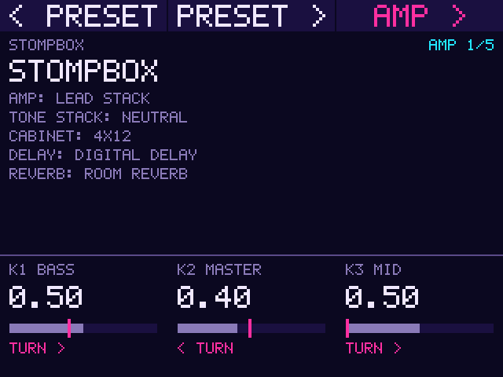
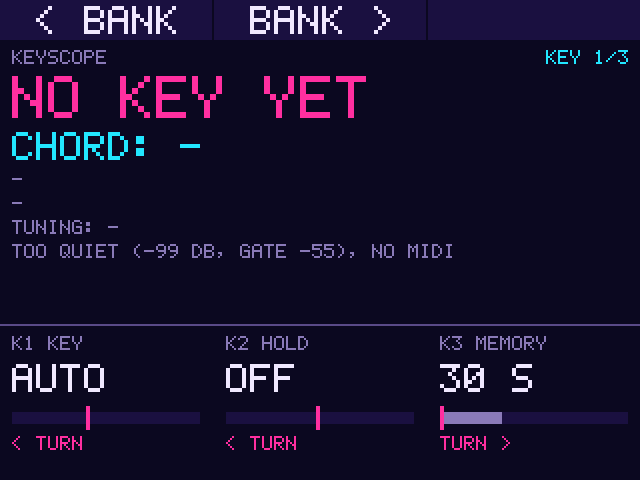
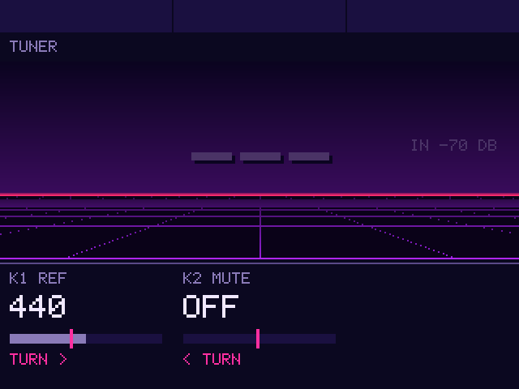

# mpc-addin-sample-draw-handler

An addin for the MPC Sample that owns the screen on behalf of the plugins and addins that draw on it. MPC's own UI on
the Sample has no plugin page, so a plugin built for it can draw a full-screen page of its own. The addin decides which
plugin may draw and puts its pixels on the panel.

 

Captured on an MPC Sample with `/snap`, with `/input` turning the dial, pressing the buttons and moving the knobs.

## Who gets the screen

One client owns it at a time, and the last one to ask wins. A plugin or another addin opens a client, draws into its own
320x240 layer and asks for the screen. It gets the whole screen at once (the previous owner is told it lost it) and
keeps it until it releases it, which closes its page. MPC's screen then comes back as MPC last drew it. The addin never
hands the screen over on its own.

A client that asks for input gets B1 to B3, the dial and the knobs instead of MPC while it has the screen. A button's release goes wherever
its press went (1.1.1), so a page that opens on MPC's own press of a key (KITLOAD on B3 Load Kit) doesn't leave MPC
thinking the key is still held.

Pages that share a name can be told apart (API 4, 1.1): `list()` returns the other open clients with their ids, and
`show_id()` shows one by id. MPC 1.4 makes two instances of a pad's Knob FX, which is why this exists. Older clients
keep working unchanged.

## The page button

A long hold (800 ms) of PAD FX opens the home page (`page_home`, default `RACK`, the sample-rack addin's manager) and
closes it again. A page the home page opened (`show()`) goes back to it. With the home page closed, or with
`page_home=-`, the hold cycles instead: MPC, then each client in the order it opened, then MPC. The hold never reaches
MPC. A short press stays MPC's and reaches it when the button is let go. `page_note`, `page_hold_ms` and `log_buttons`
are in the settings.

## For plugins

The interface is `src/mpc_sample_draw.h`. A plugin looks up `mpc_sample_draw_api` with `dlsym` rather than linking
against the addin, so it still loads where the addin isn't installed. The drawing side for plugins lives in
mpc-vst-plugins' wrapper.

## How it works

The addin wraps `ioctl` in MPC. MPC double-buffers and page-flips when its UI changes; on each flip the addin saves MPC's
new frame and paints the owner's layer over it. A client's `present()` copies its rectangle onto the screen and
refreshes it on MPC's display fd, since only the DRM master may. See mpc-vst-plugins docs/NOTES.md, 2026-11-04.

MPC Sample 1.4 presents with DRM atomic commits instead of page flips, and the addin follows those the same way (1.1,
on the device 2026-11-24). A `present()` refreshes only the rows that changed since the last one, in separate bands,
because each refresh of the SPI panel holds back MPC's audio while it runs.

## Control

On the device it listens on `127.0.0.1:6740` by default; from a computer, use `ssh -L 6740:127.0.0.1:6740 root@<device>`.

- `/status`: the clients and the owner, with refresh counts and the time spent refreshing.
- `/grant?id=N`, `/release`, `/cycle`: hand the screen around.
- `/test?on=1|0`: a built-in test pattern.
- `/input?key=K|dial=N|knob=K&value=V`: an event for the client with the screen, as if it came from the device.
- `/snap`: the screen as shown, 320x240 pixels at 4 bytes each (0x00RRGGBB little-endian, row-major).

With `/input` and `/snap` you can check a page without touching the device.

## Settings

The addin only starts in the MPC Sample's process (`/usr/bin/MPC Sample`). Settings are in
`mpc_sample_draw_handler.conf` next to the library: `enabled`, `bind`, `port`, plus the page button keys above.

## Build, test, install

`tests/test.sh` runs the host tests (ASan/UBSan, with a file standing in for the framebuffer). `./build-aarch64.sh`
builds the addin, and `tools/release-aarch64.sh <version>` packages it (it needs mpc-vst-plugins beside this repo).
Install with the zip's `install.sh`, from the [releases](https://github.com/jacob-sabella/mpc-addin-sample-draw-handler/releases).

## Known gaps

If a client's `present()` overwrites some of MPC's pixels before MPC's next flip, those pixels aren't in the saved frame.
After the release they show the owner's pixels until MPC redraws them. Like every addin on the Sample, this one is
loaded through a drop-in in `/run`, so it is gone after a reboot until that is solved.

## License

MIT.
